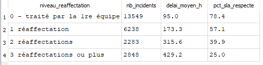
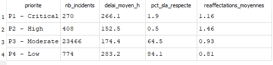
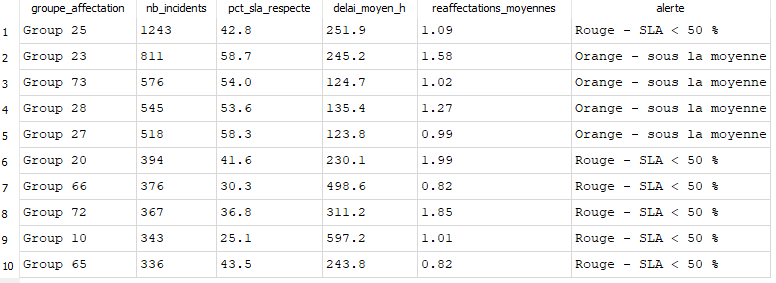

# Piloter les incidents informatiques d'une DSI avec SQL

Analyse en SQL du journal réel d'un outil de ticketing ServiceNow : **141 712 événements pour 24 918 incidents**. L'objectif est de passer d'un journal brut à des indicateurs qui permettent à une équipe IT de prioriser son activité et de fiabiliser ses données.

> Projet réalisé dans le cadre du DU Data Analytics, Université Paris 1 Panthéon-Sorbonne.

## Les données
« Incident management process enriched event log », UCI Machine Learning Repository, jeu n°498 (Amaral, Fantinato et Peres, licence CC BY 4.0, DOI [10.24432/C57S4H](https://doi.org/10.24432/C57S4H)). Journal d'audit anonymisé d'une instance ServiceNow d'une entreprise informatique.

## Les pièges des données brutes
- **Une ligne n'est pas un incident** mais une mise à jour : compter les lignes donne un résultat faux.
- **Les valeurs manquantes sont des « ? »**, pas des NULL : `IS NULL` ne trouve rien.
- **Les dates sont du texte** au format jour/mois/année sans zéro : le tri est alphabétique et aucun calcul de délai n'est possible en l'état.
- **5 événements à un état inexistant** (« -100 ») et 5 doublons de mise à jour.

## La démarche
1. **Accès et exploration** : contrôle de l'import, profil des valeurs manquantes, règles métier (matrice impact × urgence).
2. **Préparation** : conversion des dates en ISO, référentiel des états, table des événements nettoyée, table de quarantaine pour les lignes écartées, table « une ligne par incident » avec le délai de résolution.
3. **Contrôles de cohérence** : neuf règles regroupées dans une vue rejouable à chaque mise à jour.
4. **Indicateurs** : SLA, délais moyen et médian, effet des réaffectations et de l'attente utilisateur.
5. **Vues de pilotage** prêtes pour Power BI : suivi mensuel, pilotage par équipe, qualité des données.

## Résultats
| Indicateur | Valeur |
|---|---|
| Incidents dont le SLA est respecté | 63,4 % |
| Délai de résolution moyen / médian | 178 h / 22 h |
| SLA respecté : incidents critiques / modérés | 1,9 % / 64,5 % |
| SLA respecté : 0 réaffectation / 3 ou plus | 78,4 % / 25,0 % |
| Incidents clos sans date de résolution | 1 556 (6,2 %) |
| Incidents sans groupe d'affectation | 2 157 (8,7 %) |

**Ce qu'il faut retenir :** la moyenne est tirée par quelques tickets très longs, donc c'est la médiane qu'il faut afficher sur un tableau de bord. Le premier levier d'amélioration est de limiter les réaffectations entre équipes.

## Limites
- Les cibles de SLA ne figurent pas dans les données : seul l'indicateur « respecté / non respecté » est disponible.
- Les délais sont calculés en heures calendaires, pas en heures ouvrées.
- Les tickets où un article de la base de connaissances a été consulté sont plus lents. C'est une corrélation et non une causalité : on consulte surtout un article sur les tickets difficiles.

## Reproduire l'analyse
1. Télécharger les données sur la [page UCI du jeu n°498](https://archive.ics.uci.edu/dataset/498/incident+management+process+enriched+event+log) et extraire `incident_event_log.csv`.
2. Dans DB Browser for SQLite, créer une base et importer le CSV dans une table nommée `raw_incident_log`.
3. Ouvrir `analyse_incidents_itsm.sql` et tout exécuter (environ 3 secondes).

**Outils :** SQL (SQLite) · DB Browser for SQLite · modélisation de données · contrôle qualité · indicateurs de pilotage
